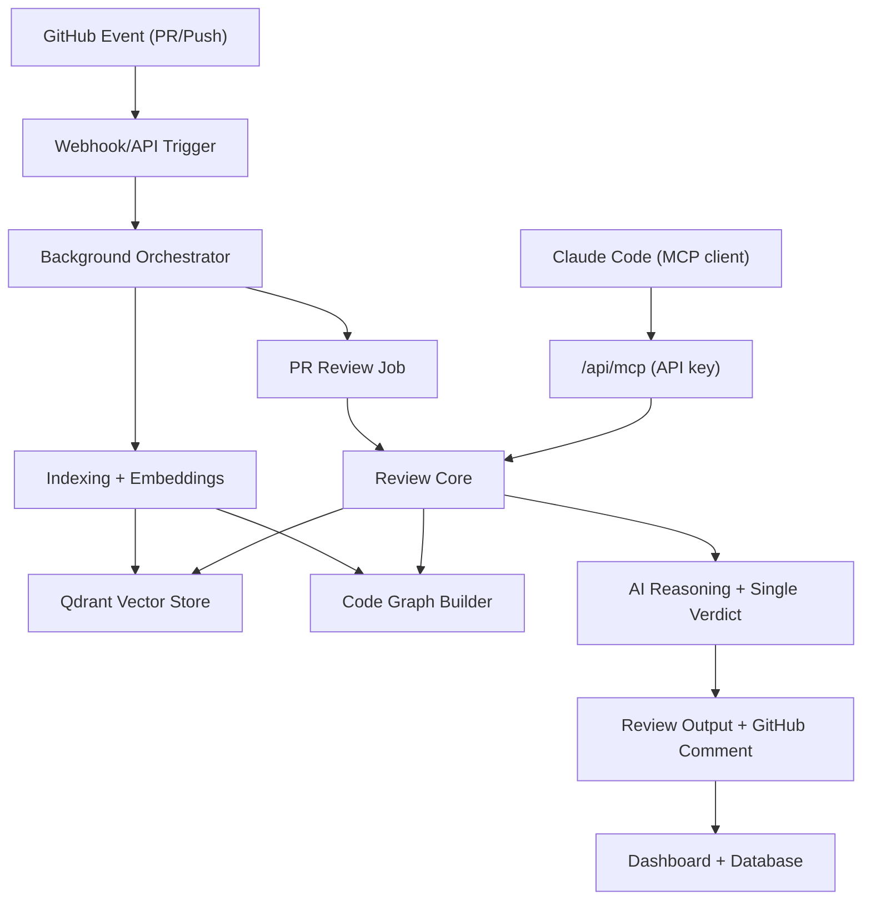

<p align="center">
  
</p>

# Revio

AI-powered code review platform for GitHub repositories.  
Revio indexes your codebase, understands structural context, and posts actionable PR feedback with risk and confidence scoring.

## Why Revio

Manual code review is slow, inconsistent, and easy to miss at scale. Revio is built to:
- catch bugs and security flaws early,
- keep review quality consistent across teams,
- reduce reviewer toil with context-aware automation,
- provide clear merge guidance (`approve` / `comment` / `request changes`).

## What You Get

- Repository indexing with semantic retrieval (vector + code graph context)
- Automated PR review on webhook events
- Manual review/re-review from dashboard
- One consistent verdict per review: risk level, recommendation and confidence agree on GitHub and in the dashboard
- PR-aware impact analysis: callers, dependent files and entry points of the code a PR actually changes
- Security scanner integrated into review flow
- Coding standards auto-detection from repo instruction files
- Interactive review assistant (`@revio-bot`)
- Chat with your codebase (Smart and Full modes)
- **Revio in Claude Code** through a hosted MCP server: review changes before you push
- A choice of review model per user (Settings → Account), with automatic fallback so reviews never fail
- Team analytics and historical trend views

## Product Surfaces

From the UI, users can:
1. Connect/disconnect GitHub repositories
2. Track indexing progress in real time (pending -> indexing -> indexed)
3. View PR review summaries and deep-dive findings
4. Trigger manual reviews and re-reviews
5. Chat with repository context
6. Configure repository review rules and ignored paths
7. Inspect organization-level analytics and activity
8. Create and revoke API keys for Claude Code (Settings → API & MCP)

## High-Level Architecture



PR reviews and reviews requested from Claude Code run through the same review core (`src/lib/services/review-core.ts`), so both get identical analysis.

## Core Components

1. **Indexer**
   - Fetches repository tree/content through GitHub API
   - Chunks code logically and generates embeddings
   - Supports full and incremental indexing
2. **Vector Layer (Qdrant)**
   - Stores embedding chunks for semantic retrieval
   - Repository-isolated collections
3. **Code Graph Engine**
   - Builds structural graph (functions, imports, calls) with tree-sitter
   - Links calls across files through resolved imports
   - Re-parses a PR's changed files so new, edited and removed functions are analyzed
   - Used for blast radius, sequence diagrams and contextual reasoning
4. **Review Core**
   - Combines a line-numbered diff + semantic context + graph context + security findings + coding standards
   - Produces issues, highlights, one final verdict (risk + recommendation), confidence
   - Shared by PR reviews and the MCP server
5. **MCP Server**
   - Hosted Streamable HTTP endpoint (`/api/mcp`), authenticated with personal API keys
   - Lets Claude Code review local changes, fetch PR reviews, check impact and search code
6. **Background Runtime**
   - Queue-first with worker support
   - Serverless fallback in hybrid mode

## Supported Languages (Indexing/Analysis)

- TypeScript / JavaScript
- Python
- Go
- Rust
- Java
- C++
- C#
- Ruby
- PHP
- Swift

Calls between files are linked through imports for TypeScript/JavaScript, Python, Java, Rust, C/C++, Ruby and PHP. Go, Java, C# and Swift also see definitions in the same package.

## Review Flow

For each PR, Revio performs:
1. Diff ingestion from GitHub (ignored paths are skipped in every step)
2. Semantic context retrieval from vector store
3. Code graph impact analysis on the PR's own version of the changed files
4. Security scan on added lines
5. AI review generation (with reasoning enabled) on a line-numbered diff
6. One final verdict: risk is never lower than the issues imply, Revio never approves a PR with warnings, and confidence is capped by the verdict
7. GitHub review posting: a short review led by the verdict, one findings table, and inline comments for critical and warning findings
8. Dashboard persistence for tracking and analytics

## Use Revio in Claude Code (MCP)

Revio runs as a hosted MCP server, so there is nothing to install.

1. In Revio, open **Settings → API & MCP** and create an API key (it is shown once).
2. Add Revio to Claude Code:

```bash
claude mcp add --transport http revio https://<your-domain>/api/mcp \
  --header "Authorization: Bearer <your-revio-api-key>" --scope user
```

3. Run `/mcp` in Claude Code to check that Revio is connected.

Available tools:

| Tool | What it does |
|------|--------------|
| `review_changes` | Reviews a local diff (for example `git diff main...HEAD`) with the full PR review analysis; nothing is posted to GitHub |
| `get_pr_review` | Fetches Revio's review of a pull request so Claude can fix the issues |
| `get_impact` | Callers, dependent files and entry points for files or functions |
| `search_codebase` | Semantic search across indexed repositories |
| `list_repositories` | Connected repositories and their index status |

Reviews requested through MCP count toward the plan's review limits. Keys are stored only as hashes and can be revoked at any time. For teams, commit a `.mcp.json` that reads the key from a `REVIO_API_KEY` environment variable (shown in Settings → API & MCP).

## Chat

- **Smart mode**: searches for the code most relevant to each question
- **Full mode**: adds the repository file structure to the relevant code, for architecture questions
- Chat messages count toward plan limits (Free: 50/month and 10/hour, Pro: 500/month and 100/hour, Team: unlimited)

## Data Lifecycle and Deletion

On repository disconnect:
- Repository-scoped records are removed from app DB (indexed files, chats, PR reviews, code graph, standards, review-learning links)
- Qdrant collection for that repository is deleted

Operational telemetry/history may remain (for platform observability), but repository content/context is removed.

## Security Posture

- GitHub auth via GitHub App/OAuth flow
- Encrypted token handling at rest (AES-256-GCM in app logic)
- Signed webhook verification
- Stateless processing-oriented architecture
- Security scanning integrated into review generation

## Tech Stack

- **Frontend/API**: Next.js 15 (App Router)
- **Runtime**: Node.js 24.x
- **Database**: PostgreSQL + Prisma
- **Vector DB**: Qdrant
- **Queue**: BullMQ + Redis
- **Integrations**: GitHub App / Octokit, MCP (`@modelcontextprotocol/sdk`)
- **AI**: a large language model for reviews and chat (reviews use reasoning), an embedding model for semantic search
- **Code analysis**: tree-sitter (with Babel fallback for JS/TS)

## Getting Started

### Prerequisites

- Node.js 24.x (`nvm use` supported via `.nvmrc`)
- PostgreSQL
- Redis
- Qdrant

### Install

```bash
git clone https://github.com/mayurbijarniya/Revio.git
cd Revio
npm install
cp .env.example .env
```

### Database Setup

```bash
npx prisma db push
npx prisma generate
```

### Run App

```bash
npm run dev
```

## Environment Configuration

Use `.env.example` as source-of-truth.

Important groups:
- App/Auth: `NEXT_PUBLIC_APP_URL`, `SESSION_SECRET`, `ENCRYPTION_KEY`
- DB: `DATABASE_URL` (and `DIRECT_URL` if needed)
- GitHub: `GITHUB_APP_ID`, `GITHUB_APP_CLIENT_ID`, `GITHUB_APP_CLIENT_SECRET`, `GITHUB_APP_PRIVATE_KEY`, `GITHUB_APP_WEBHOOK_SECRET`
- AI: `GOOGLE_AI_API_KEY`, `OPENAI_API_KEY`, optional `SUBCONSCIOUS_API_KEY` (enables the second review model)
- Infra: `QDRANT_URL`, `QDRANT_API_KEY`, `UPSTASH_REDIS_REST_URL`, `UPSTASH_REDIS_REST_TOKEN`
- Ops: `CRON_SECRET`, `BACKGROUND_MODE`

### `BACKGROUND_MODE`

- `hybrid` (recommended): queue-first + serverless fallback
- `queue`: queue-only, requires persistent workers
- `serverless`: no queue workers required

## Worker Runtime

When using queue mode (`hybrid`/`queue`), run workers continuously:

```bash
npm run worker
```

Or split workers:

```bash
npm run worker:indexing
npm run worker:review
```

See: `docs/worker-deployment.md`

## Health Endpoints

- `GET /api/health/live`
- `GET /api/health/ready`
- `GET /api/health/deps`

## Test and Validation

```bash
npm run type-check
npm run lint
npm run test
```

Before opening a PR, run the validation commands above so Revio can focus its review on the actual code changes.

### Offline Evaluation

`npm run eval` measures review quality on real bugs from BugsInPy, BugsJS and Defects4J. Each benchmark fix is reversed into a bug-introducing PR and reviewed twice: with the diff only and with full Revio context. It reports the catch rate, unmatched issues per PR (false-positive candidates) and approvals of buggy PRs.

```bash
# Check bug selection without calling the model
npm run eval -- --dry-run --per-dataset 2

# Full run (needs GOOGLE_AI_API_KEY; GITHUB_TOKEN recommended)
GOOGLE_AI_API_KEY=... GITHUB_TOKEN=... npm run eval -- --per-dataset 20
```

Results are written to `eval-results/` (git-ignored). It runs locally only and is not part of the deployed app.

## Production Checklist

1. Set production env vars
2. Apply database changes:
   - Run new migration SQL from `prisma/migrations/` in the Supabase SQL Editor (migrations are written to be safe to run more than once)
3. Configure GitHub App permissions (`pull_requests`, `issue_comments`, `contents`)
4. Set webhook URL:
   - `https://<your-domain>/api/webhooks/github`
5. Re-index repositories after code graph changes
6. Verify the PR review flow end-to-end, and the MCP connection from Claude Code (`/mcp`)

## Roadmap

- Codex support for the MCP server
- Better monorepo scale and retrieval efficiency
- Auto-fix workflow support
- More IDE integrations

## Contributing

Issues and PRs are welcome.

## License

MIT. See [LICENSE](./LICENSE).
